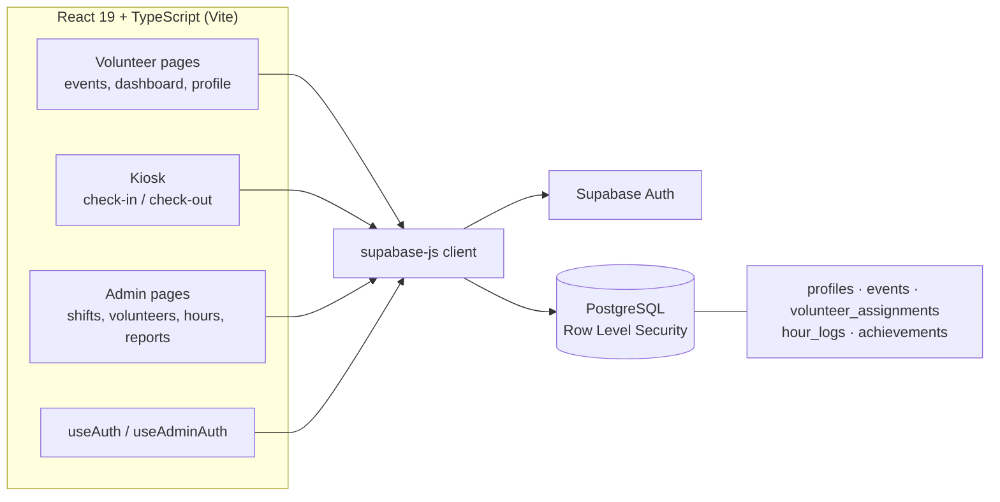

# Volunteer Management Platform

A volunteer portal built in collaboration with Harry Chapin Food Bank of Southwest Florida: volunteers sign up, register for events and shifts, and check in at a kiosk, while staff schedule shifts, review hours and pull reports.

[Deployed build](https://service-learning-project-lyart.vercel.app) · React 19 · TypeScript · Supabase · Vite

> [!NOTE]
> This is a student service-learning project built with the food bank as the community partner. It is not the food bank's official volunteer system. Branding and documents in `public/` belong to Harry Chapin Food Bank.

## The problem

Coordinating volunteers across events means tracking who signed up, who showed up and how many hours they served. Doing that with sign-in sheets and spreadsheets makes reporting slow and error-prone. This app puts registration, attendance and hours in one place with a database behind it.

## Features

Everything below is implemented in `src/`.

| Area | What it does | Main files |
|---|---|---|
| Accounts | Email and password sign-up and login through Supabase Auth, volunteer profile with skills, availability and emergency contact | `SignupPage`, `LoginPage`, `ProfilePage`, `useAuth` |
| Events and shifts | Browse events, register for a shift, capacity limits, cancel a registration, calendar view | `EventsPage`, `EventRegistrationModal`, `Calendar` |
| Volunteer dashboard | Upcoming assignments, logged hours and achievements | `DashboardPage` |
| Kiosk mode | On-site check-in and check-out that writes hour logs | `KioskPage` |
| Admin: shifts | Create and edit shifts, see and manage who is assigned | `AdminShiftsPage`, `ShiftManagementModal`, `VolunteerAssignmentsModal` |
| Admin: volunteers | Search volunteers, view details and status history | `AdminVolunteersPage`, `VolunteerDetailsModal` |
| Admin: hours | Review, approve or reject logged hours | `AdminHoursPage` |
| Reporting | Per-volunteer and summary reports with export | `ReportsPage`, `VolunteerReportModal` |
| Access control | Separate admin login and guarded admin routes, Row Level Security in the database | `useAdminAuth`, `docs/database/` |

## Architecture



There is no custom backend server. The React app talks to Supabase directly, and access rules are enforced by Row Level Security policies in `docs/database/`.

## Tech stack

| Layer | Tools |
|---|---|
| Frontend | React 19, TypeScript, React Router, react-big-calendar, custom CSS design system |
| Build | Vite 7 |
| Backend | Supabase (PostgreSQL, Auth, Row Level Security) |
| Testing | Vitest, React Testing Library, Playwright |
| Quality | ESLint, Prettier, Husky pre-commit hooks |
| Hosting | Vercel |

## Project structure

```
src/
├── components/
│   ├── admin/          # Shift, assignment, volunteer and report modals
│   ├── scheduling/     # Event registration
│   └── shared/         # Navbar, Calendar, DatePicker
├── hooks/              # useAuth, useAdminAuth, useSupabase
├── pages/              # Volunteer pages, kiosk, reports
│   └── admin/          # Admin dashboard, shifts, volunteers, hours
├── services/           # Supabase client and API helpers
├── types/              # TypeScript types
├── utils/              # Date formatting, validation
└── theme.ts            # Design tokens
tests/
├── e2e/                # Playwright user journeys
└── acceptance/         # Playwright requirement checks
docs/
└── database/           # SQL schema, migrations and RLS policies
```

## Setup Instructions

### Prerequisites
- Node.js 20+ (LTS recommended)
- npm or yarn package manager
- Git
- Supabase account (for backend services)

### Installation

1. **Clone the repository**
   ```bash
   git clone https://github.com/krocks9903/ServiceLearningProject.git
   cd ServiceLearningProject
   ```

2. **Install dependencies**
   ```bash
   npm install
   ```

3. **Environment Configuration**
   Copy the template and fill in your Supabase values:
   ```bash
   cp .env.example .env.local
   ```

4. **Database Setup**
   - Create a new Supabase project
   - Run `docs/database/DATABASE_SETUP.sql` first, then the `ADD_*` and `CREATE_*` scripts. The `FIX_*`, `DEBUG_*` and `DIAGNOSE_*` files are one-off repair scripts from development and are not needed for a fresh setup
   - Configure Row Level Security (RLS) policies as needed

5. **Start Development Server**
   ```bash
   npm run dev
   ```

6. **Access the Application**
   Open [http://localhost:5173](http://localhost:5173) in your browser

### Available Scripts

- `npm run dev` - Start development server
- `npm run build` - Build for production
- `npm run preview` - Preview production build
- `npm run lint` - Run ESLint
- `npm run lint:fix` - Fix ESLint issues
- `npm run type-check` - Run TypeScript type checking

## Database schema

Tables the app reads and writes:

- **profiles**: volunteer profile and role information
- **events**: volunteer events and opportunities
- **volunteer_assignments**: who is registered for which event or shift
- **hour_logs**: check-in and check-out records and approved hours
- **achievements**: milestones shown on the dashboard
- **volunteer_status_history**, **volunteer_onboarding**, **volunteer_group_memberships**: admin tracking
- **admin_volunteer_summary**: reporting view

## Security

- **Authentication**: Supabase Auth with email and password
- **Authorization**: separate admin login, admin-only routes, and Row Level Security policies (`docs/database/FIX_RLS_POLICIES.sql`, `ADMIN_SYSTEM_MIGRATION.sql`)
- **Secrets**: only the Supabase URL and anon key reach the browser. No service-role key is used in the client
- **Validation**: form validation helpers in `src/utils/validations.ts`

## Contributing

Please read our [Contributing Guidelines](docs/CONTRIBUTING.md) for details on our code of conduct and the process for submitting pull requests.

### Development Workflow

1. Fork the repository
2. Create a feature branch (`git checkout -b feature/amazing-feature`)
3. Commit your changes (`git commit -m 'Add amazing feature'`)
4. Push to the branch (`git push origin feature/amazing-feature`)
5. Open a Pull Request

## Testing

The project has tests at five levels. Current state on `main`, measured locally:

| Suite | Command | Result |
|---|---|---|
| Unit | `npm run test:unit` | 105 of 105 passing |
| Integration | `npm run test:integration` | 8 of 23 passing (Dashboard and Login page suites need their Supabase mocks updated) |
| Type check | `npm run type-check` | passing |
| Production build | `npm run build` | passing |
| Lint | `npm run lint` | 119 errors, mostly `no-explicit-any` |
| End-to-end and acceptance | `npm run test:e2e`, `npm run test:acceptance` | need a running app and a Supabase project |

Vitest needs `VITE_SUPABASE_URL` and `VITE_SUPABASE_ANON_KEY` set (any placeholder value works for unit tests), otherwise the Supabase client throws on import.

### Testing Levels

1. **Unit Testing** - Component-level testing (`src/**/*.test.{ts,tsx}`)
   - Tests individual functions and components in isolation
   - Fast execution with mocked dependencies
   - Run: `npm run test:unit`

2. **Integration Testing** - Component interaction testing (`src/**/*.integration.test.{ts,tsx}`)
   - Tests how components work together
   - Includes API/service integration
   - Run: `npm run test:integration`

3. **Product Testing (E2E)** - End-to-end application testing (`tests/e2e/*.spec.ts`)
   - Tests complete user workflows
   - Runs in real browser environments
   - Run: `npm run test:e2e`

4. **Acceptance Testing** - Business requirement validation (`tests/acceptance/*.spec.ts`)
   - Validates business requirements and user stories
   - Tests from user perspective
   - Run: `npm run test:acceptance`

5. **Regression Testing** - Automated test suite execution
   - Runs all tests to ensure no regressions
   - Integrated with CI/CD pipeline
   - Run: `npm run test:regression` or `npm run test:all`

### Running Tests

```bash
# Run all tests
npm run test:all

# Run specific test suite
npm run test:unit          # Unit tests only
npm run test:integration   # Integration tests only
npm run test:e2e          # E2E tests only
npm run test:acceptance   # Acceptance tests only

# Generate coverage report
npm run test:coverage

# Watch mode (unit and integration)
npm run test:watch

# Test UI
npm run test:ui
```

### Test Coverage

- Target: 80%+ code coverage for unit tests
- Coverage reports generated in `coverage/` directory
- HTML, JSON, and LCOV formats available

For detailed testing documentation, see [TESTING.md](docs/TESTING.md)

## Deployment

### Production Deployment

1. **Build the application**
   ```bash
   npm run build
   ```

2. **Deploy to your hosting platform**
   - Vercel (used for the current deployment)
   - Netlify
   - AWS S3 + CloudFront
   - Any static hosting service

3. **Configure environment variables** in your hosting platform

4. **Set up Supabase** for production database and authentication

### Environment Variables

Ensure the following environment variables are set in production:

- `VITE_SUPABASE_URL` - Your Supabase project URL
- `VITE_SUPABASE_ANON_KEY` - Your Supabase anonymous key

## Troubleshooting

### Common Issues

1. **Build Errors**: Ensure all dependencies are installed and Node.js version is compatible
2. **Database Connection**: Verify Supabase credentials and project status
3. **Authentication Issues**: Check Supabase Auth configuration and RLS policies
4. **Performance Issues**: Review browser console for errors and check network requests

### Getting Help

- Check the [Issues](https://github.com/krocks9903/ServiceLearningProject/issues) page
- Review the [Documentation](docs/) folder
- Contact the development team

<details>
<summary><b>Development methodology (course write-up)</b></summary>

This project was developed using a combination of **Rapid Prototyping**, **Iterative Development**, and **Incremental Delivery** methodologies:

### Rapid Prototyping
- Initial MVP was built quickly to validate core concepts
- Focused on essential features: authentication, volunteer registration, event management
- Used modern tooling (Vite, React 19) for fast development cycles
- Leveraged Supabase for rapid backend setup

### Iterative Development
- Continuous refinement of features based on user feedback
- Regular code reviews and refactoring
- Progressive enhancement of UI/UX components
- Database schema evolution through migration scripts

### Incremental Delivery
- Features delivered in small, manageable increments
- Each increment builds upon previous functionality
- Modular architecture allows for independent feature development
- Version-controlled releases with clear feature sets

</details>

## Known limitations

- **CI is currently failing.** The pipeline stops at the lint step, so the test and deploy jobs are skipped. `performance.yml` also calls npm scripts (`lighthouse`, `analyze`, `test:web-vitals`) that do not exist in `package.json`.
- **Integration tests are partly out of date** (see the table above).
- **No AI features.** The `openai` package is listed in `package.json` but nothing in `src/` imports it.
- **No realtime subscriptions or route-level code splitting yet.** Pages fetch on load and the app ships as one bundle.
- **Generated files are committed** (`playwright-report/`, `test-results/`).

## Possible next steps

- Get CI green: fix or relax the `no-explicit-any` rule, run Prettier, repair the two integration suites
- Add Supabase-generated types to replace `any`
- Lazy-load admin routes
- Email reminders for upcoming shifts

## Team

Built as an FGCU service-learning project. Contributors are listed on the [contributors page](https://github.com/krocks9903/ServiceLearningProject/graphs/contributors).

## License

MIT. See [LICENSE](LICENSE).
